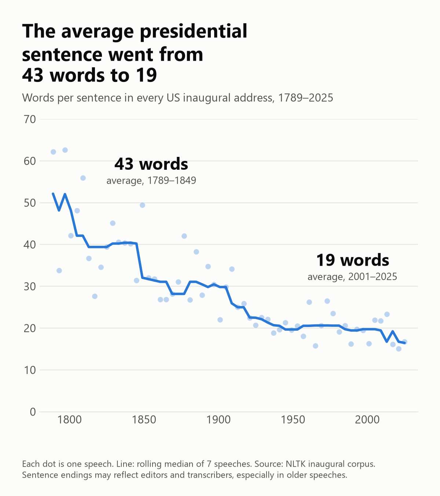
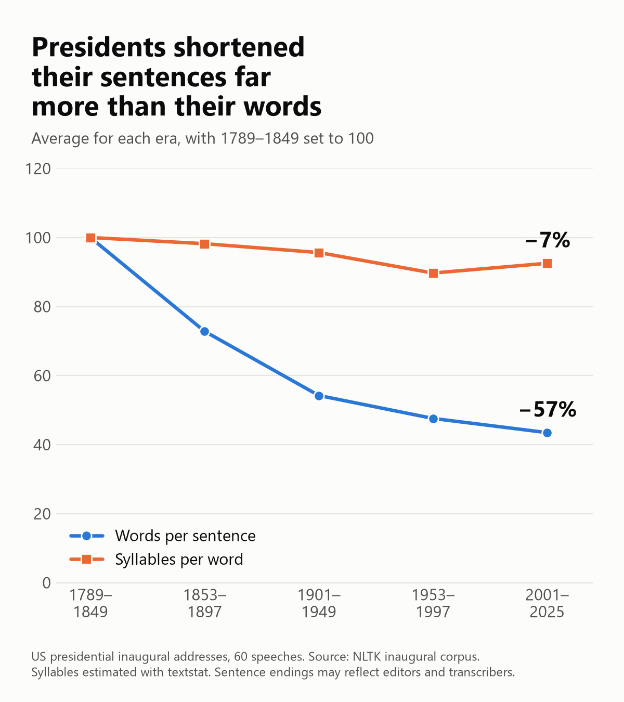
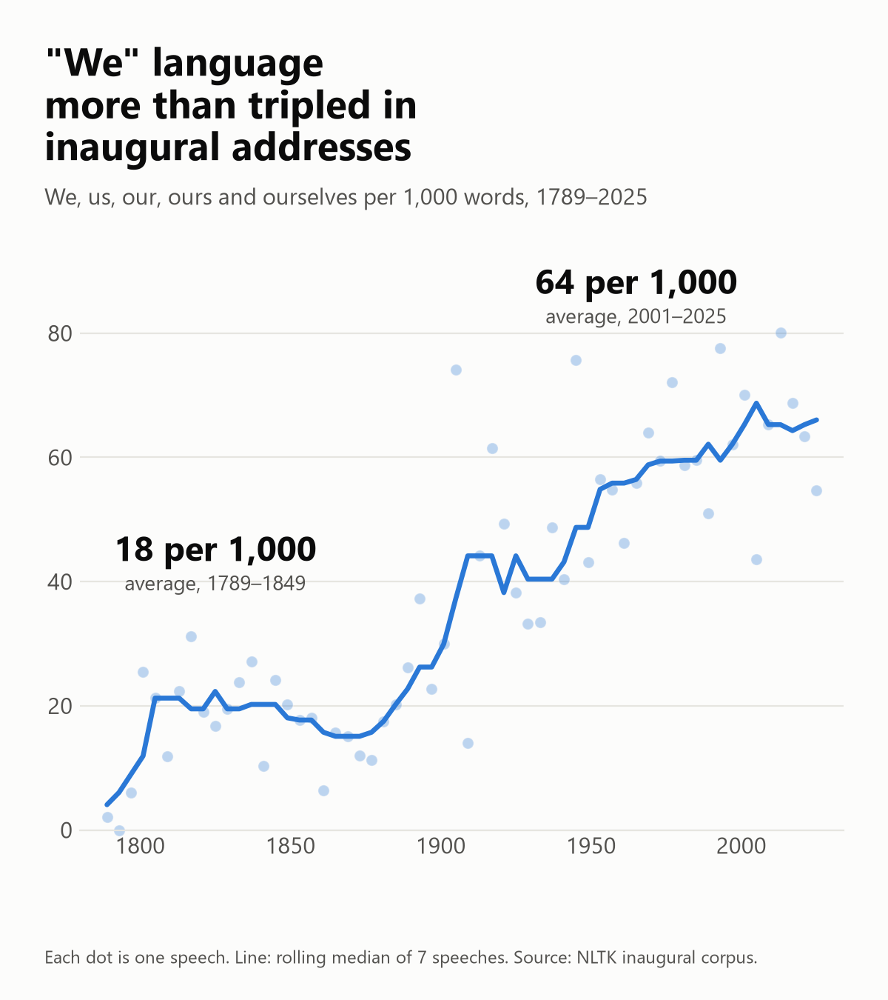
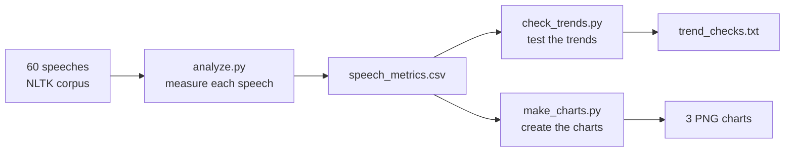

<div align="center">

# 🇺🇸 236 Years of US Inaugural Addresses

**How has the way presidents speak changed since 1789?**<br>
A reproducible text analysis of all 60 US presidential inaugural addresses, 1789–2025.

[](https://www.python.org/)
[](https://www.nltk.org/)
[](https://pandas.pydata.org/)
[](https://matplotlib.org/)
<br>
[](#-the-dataset)
[](#-the-dataset)
[](LICENSE)
[](https://github.com/sathiyasri-s/inaugural-speech-analysis/commits/main)

[Findings](#-what-we-found) · [Dataset](#-the-dataset) · [Method](#-method) · [Limits](#-limits) · [Run it](#-run-it-yourself)

</div>

---

## 📌 At a glance

| | 1789–1849 | 2001–2025 | Change |
|---|---:|---:|---:|
| **Words per sentence** | 43 | 19 | **−57%** |
| **"We" language** per 1,000 words | 18 | 64 | **more than tripled** |
| **Syllables per word** | 1.65 | 1.53 | **−7%** |
| **Flesch-Kincaid grade** | 20.7 | 9.9 | **about 11 grades lower** |

> **In one sentence:** presidents now use much shorter sentences and say "we" far more often, but their choice of words has changed much less.



## 📚 The dataset

The project uses the **inaugural address corpus from [NLTK](https://www.nltk.org/nltk_data/)**, a popular open-source Python library for working with text. Each speech is one plain-text file, named by year and president, such as `1789-Washington.txt`. An inaugural address is the speech a president gives at the start of a term, which makes these speeches a rare long-running record: the same occasion, repeated from 1789 to today.

| Property | Value |
|---|---|
| **Speeches** | 60, with one for every four-year cycle from 1789 to 2025 |
| **Total size** | 140,692 words in 5,363 sentences |
| **Typical speech** | 2,111 words (median) |
| **Longest speech** | Harrison, 1841: 8,446 words |
| **Shortest speech** | Washington, 1793: 135 words |
| **Format** | Plain text, with no labels or metadata beyond the file name |
| **Origin** | Compiled by Kathleen Ahrens from C-SPAN sources, according to the corpus notes |

## ❓ What we wanted to find out

1. **Reading level:** did inaugural addresses become easier to read?
2. **Sentences and words:** if so, was that because of shorter sentences, simpler words, or both?
3. **"I" and "we":** did presidents move from "I" to "we"?
4. **Timing:** when did any change happen, and is it still going on?
5. **Tone:** did speeches become more positive or more negative?

## 🔍 What we found

| # | Question | Answer | Evidence |
|---|---|---|---|
| 1 | Easier to read? | ✅ **Yes** | The Flesch-Kincaid grade fell from 20.7 to 9.9 |
| 2 | Sentences or words? | ✅ **Mostly sentences** | Sentences became 57% shorter; syllables per word fell 7% |
| 3 | "I" replaced by "we"? | ❌ **Not supported** | "We" rose strongly, but "I" shows no trend since 1900 |
| 4 | When? | ⚠️ **Mostly before 1950** | No clear reading-level trend since then, from only 19 speeches |
| 5 | Tone change? | ❌ **No reliable evidence** | The link is weak, and the tool suits modern text better |

### 1. Sentences became far shorter

The average sentence fell from 43 words in 1789–1849 to 19 in 2001–2025. The longest averages belong to Adams in 1797 (62.6 words) and Washington in 1789 (62.2 words). The shortest are Biden in 2021 (15.0), Johnson in 1965 (15.8) and Trump in 2017 (16.2).

### 2. Sentences changed far more than words

Syllables per word fell only 7%, compared with 57% for sentence length. Most of the drop in reading level therefore comes from how long the sentences are, not from how complex the words are. Syllables per word also reached their lowest point in 1953–1997 and rose slightly afterwards, so this isn't a steady decline.



### 3. "We" language more than tripled

We, us, our, ours and ourselves rose from 18 to 64 uses per 1,000 words, with the largest jump around 1900. Washington's 1789 speech scored about 2, while Obama's 2013 speech scored about 80, the highest in the collection.



### 4. The expected story that failed

I expected "I" to give way to "we". "I" language did fall early on, from 22 to 8 per 1,000 words by 1901–1949, but it shows no trend after 1900 (correlation +0.12), while "we" kept rising. One didn't simply replace the other.

### 5. Reading level has shown no clear trend since 1950

The grade averages 9.8 for 1953–1997 and 9.9 for 2001–2025 (correlation with year since 1950: −0.07, p = 0.77). With only 19 speeches in this period, this means no clear trend was detected, not that the change has definitely stopped.

<details>
<summary><b>📊 Averages by era</b></summary>

| Era | Speeches | Words per sentence | Flesch-Kincaid grade | Syllables per word | "We" per 1,000 | "I" per 1,000 |
|---|---:|---:|---:|---:|---:|---:|
| 1789–1849 | 16 | 43.1 | 20.7 | 1.65 | 17.6 | 22.2 |
| 1853–1897 | 12 | 31.4 | 15.8 | 1.62 | 18.3 | 14.4 |
| 1901–1949 | 13 | 23.4 | 12.1 | 1.58 | 45.1 | 7.9 |
| 1953–1997 | 12 | 20.5 | 9.8 | 1.48 | 59.8 | 9.9 |
| 2001–2025 | 7 | 18.7 | 9.9 | 1.53 | 63.7 | 10.3 |

"I" counts I, me, my, mine and myself. "We" counts we, us, our, ours and ourselves.

</details>

## 🔬 Method



| Measure | How it's calculated |
|---|---|
| **Words per sentence** | Words ÷ sentences, with sentences split by NLTK |
| **Reading grade** | Flesch-Kincaid and Gunning Fog, from `textstat` |
| **"We" and "I" language** | Regex counts per 1,000 words. All-capital "US" isn't counted as "us" |
| **Tone** | VADER score, averaged sentence by sentence |

Era figures are the mean across speeches, so each speech counts equally whatever its length.

### How the findings were tested

A single calculation can mislead, so `check_trends.py` repeats the analysis in different ways. Each column below shows the Spearman rank correlation with year under a different test.

| Measure | All 60 | Speeches of 1,000+ words | Without 2017–2025 | Since 1900 only |
|---|---:|---:|---:|---:|
| Words per sentence | −0.88 | −0.88 | −0.86 | −0.54 |
| Flesch-Kincaid grade | −0.88 | −0.89 | −0.87 | −0.60 |
| Gunning Fog | −0.89 | −0.90 | −0.89 | −0.68 |
| Coleman-Liau | −0.73 | −0.75 | −0.72 | −0.38 |
| Syllables per word | −0.61 | −0.64 | −0.61 | −0.23 |
| **"We" language** | **+0.83** | **+0.85** | **+0.83** | **+0.52** |
| "I" language | −0.44 | −0.45 | −0.53 | +0.12 |
| Tone | −0.38 | −0.48 | −0.34 | −0.06 |

The script also runs permutation tests, compares the trend before and after 1950, and reports means and medians by era. The full output is in [`results/trend_checks.txt`](results/trend_checks.txt).

## 🚧 Limits

- **Punctuation:** the main finding depends on where sentences end, which may reflect editors and transcribers, especially in older speeches. This data can't rule that out.
- **Spoken and prepared text:** some recent text appears to follow the speech as delivered, while older text reads as prepared. Removing the three most recent speeches barely changes the trend, but this can't be tested across the whole collection.
- **Causes:** the data shows when things changed, not why. Radio, television and wider education are possible explanations, but none is tested here.
- **Grade levels:** a score of 20 isn't a real school grade. It's best read as a relative measure, driven by very long sentences.
- **Formula design:** Flesch-Kincaid and Gunning Fog both rely heavily on sentence length, so they aren't fully independent evidence for finding 1.
- **Small sample:** there are only 60 speeches, and just 7 in the latest era.
- **One occasion:** inaugural addresses are formal ceremonial speeches, so these results may not apply to how presidents speak in general.

## 🚀 Run it yourself

Requires Python 3.10 or newer. It was tested on Python 3.14 on Windows 11.

```bash
git clone https://github.com/sathiyasri-s/inaugural-speech-analysis.git
cd inaugural-speech-analysis
pip install -r requirements.txt

python analyze.py        # measures all 60 speeches
python check_trends.py   # tests the trends
python make_charts.py    # creates the charts
```

NLTK's data downloads automatically the first time `analyze.py` runs. Running the scripts from an empty folder reproduced the results and charts in this repo exactly.

### Output

`results/speech_metrics.csv` has one row per speech:

| year | president | word_count | sentence_count | avg_sentence_length | flesch_kincaid_grade | plural_per_1000 |
|---:|---|---:|---:|---:|---:|---:|
| 1789 | Washington | 1,430 | 23 | 62.2 | 28.4 | 2.1 |
| 1865 | Lincoln | 699 | 26 | 26.9 | 11.8 | 15.7 |
| 1961 | Kennedy | 1,364 | 52 | 26.2 | 11.5 | 46.2 |
| 2025 | Trump | 2,928 | 175 | 16.7 | 10.3 | 54.6 |

The file also includes `gunning_fog`, `singular_per_1000` and `avg_sentence_tone`.

## 📁 Project structure

```text
inaugural-speech-analysis/
├── analyze.py              # measures every speech
├── check_trends.py         # tests whether the trends hold up
├── make_charts.py          # creates the charts
├── requirements.txt        # Python dependencies
├── charts/                 # the three charts
├── results/
│   ├── speech_metrics.csv  # one row per speech
│   └── trend_checks.txt    # output of the tests
├── LICENSE
└── README.md
```

## 🧰 Built with

[NLTK](https://www.nltk.org/) (corpus, tokenizing, VADER) · [textstat](https://github.com/textstat/textstat) (readability) · [pandas](https://pandas.pydata.org/) and [NumPy](https://numpy.org/) (analysis) · [Matplotlib](https://matplotlib.org/) (charts)

## 📄 License

The code is available under the [MIT License](LICENSE).
